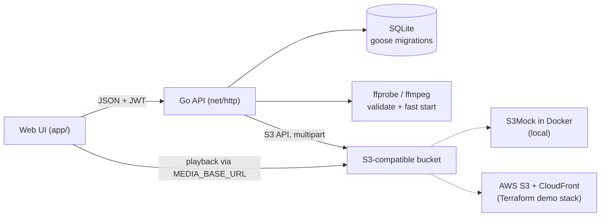

# Tubely

[](https://github.com/danielakinremi1-dev/Tubely-video-manager/actions/workflows/ci.yml)

Tubely is a video-hosting backend written in Go. Users sign up, create video drafts, upload an MP4 and a thumbnail, and play the videos back from S3-compatible object storage. It started as a course starter project and is being built up, one reviewable phase at a time, into a production-shaped service: validated uploads, multipart transfers to S3, versioned database migrations, and infrastructure as code.

Everything runs on your machine. You don't need an AWS account.

## Features

- **Auth:** argon2id password hashes, 1-hour JWT access tokens, and refresh tokens stored in the database so they can be revoked. The web UI refreshes expired access tokens on its own.
- **Uploads that check what they receive:**
  - The file type is detected from the file's bytes, not the client's `Content-Type`.
  - Size limits: 1 GB for videos, 10 MB for thumbnails.
  - ffprobe confirms the file is a playable video.
  - Every failure returns the right status code with a JSON error: `400`, `401`, `403`, `404`, `413`, `415`, `422` or `500`.
- **Streaming-ready video:** ffmpeg remuxes each upload for *fast start*, moving the `moov` index before the media data, so playback and seeking begin before the whole file downloads.
- **Object keys sorted by shape:** videos are stored under `landscape/`, `portrait/` or `other/`, based on their aspect ratio.
- **S3 transfers:** files over 16 MiB are sent as parallel 8 MiB multipart uploads with retries. Failed or cancelled uploads are aborted, so no parts or objects are left behind.
- **Keys, not URLs:** the database stores object keys, and public URLs are built from `MEDIA_BASE_URL` for each response. Switching the bucket or CDN takes no data migration.
- **No orphaned objects:** deleting a video, or replacing its file or thumbnail, removes the old objects from storage.
- **Versioned schema:** [goose](https://github.com/pressly/goose) migrations are embedded in the binary and run at startup. Foreign keys are enforced and cascade on delete.

## Architecture



An upload works like this:
1. Authenticate and check that the user owns the video.
2. Cap the body size and detect the file type from its bytes.
3. Probe the file with ffprobe for its aspect ratio.
4. Remux it with ffmpeg for fast start.
5. Upload it to the bucket under a random UUID key.
6. Save the key in SQLite and delete the previous object.

## What runs where

| Piece | Locally (default) | AWS demo stack |
|---|---|---|
| API and web UI | `go run ./cmd/tubely`, or the Docker image (`make up-app`) | Still on your machine (`make dev-aws`) |
| Database | SQLite file (`DB_PATH`) | SQLite file (`tubely-aws.db`) |
| Media storage | [S3Mock](https://github.com/adobe/S3Mock) in Docker on `:9090` | Private S3 bucket, served through CloudFront with Origin Access Control |

The AWS stack is Terraform in [`infra/`](infra). `make aws-up` creates it for a demo, and `make aws-down` destroys it and checks that nothing is left. It isn't kept running, to avoid charges. It was last demonstrated end to end on 2026-11-09 and then destroyed: the smoke test passed against CloudFront, direct S3 reads were denied, and the app's role could upload and delete but not read. The runbook is [docs/AWS_DEMO.md](docs/AWS_DEMO.md). The app's code is the same in both setups; only the configuration changes.

## Prerequisites

- [Go](https://go.dev/doc/install) 1.27 or newer, plus a C compiler for the SQLite driver (cgo): `build-essential` on Debian/Ubuntu, or the Xcode command line tools on macOS.
- [Docker](https://docs.docker.com/get-docker/) with Compose v2, which runs the S3 emulator.
- [FFmpeg](https://ffmpeg.org/download.html). Both `ffmpeg` and `ffprobe` must be on your `PATH`.

  ```bash
  # Debian/Ubuntu
  sudo apt update && sudo apt install ffmpeg

  # macOS
  brew install ffmpeg
  ```

- Optional: [SQLite 3](https://www.sqlite.org/download.html), to inspect the database by hand (`sudo apt install sqlite3` or `brew install sqlite3`).

## Quickstart

```bash
cp .env.example .env     # the local defaults work as they are
make dev                 # starts the S3 emulator (docker compose up -d), then the server
```

Open **http://localhost:8091/app/**. Requests to `/` return 404 by design; the UI lives at `/app/`.

To get sample videos and images to upload:

```bash
./samplesdownload.sh     # downloads them into samples/
```

**Or run everything in Docker**, with no Go or ffmpeg on your machine:

```bash
make up-app              # builds the image and starts S3 + the API on :8091
```

Other commands:

```bash
make down                # stop the containers; uploads are kept
docker compose down -v   # stop them and delete all uploaded media
```

## Configuration

All settings are environment variables, read from `.env` if it exists. The defaults in `.env.example` target the local emulator.

| Variable | Required | Purpose |
|---|---|---|
| `DB_PATH` | yes | SQLite database file, created if missing |
| `JWT_SECRET` | yes | Secret used to sign access tokens |
| `PLATFORM` | yes | `dev` enables `POST /admin/reset` |
| `FILEPATH_ROOT` | yes | Directory the web UI is served from (`./app`) |
| `PORT` | yes | HTTP port |
| `S3_BUCKET`, `S3_REGION` | yes | Media bucket and its region |
| `MEDIA_BASE_URL` | yes* | Public base URL that object keys are served from |
| `S3_ENDPOINT` | no | Custom S3 endpoint, such as the emulator. Leave it unset for AWS. |
| `S3_FORCE_PATH_STYLE` | no | `true` for emulators, which need `host/bucket/key` URLs |
| `AWS_ACCESS_KEY_ID`, `AWS_SECRET_ACCESS_KEY` | no | Placeholders for the emulator. On AWS, use your normal credentials or profile. |
| `S3_ROLE_ARN` | no | A role to assume for temporary S3 credentials (the AWS demo uses one) |

\* `S3_CF_DISTRO` (a CloudFront domain) is still accepted in place of `MEDIA_BASE_URL`, for older configurations.

To use a different settings file, set `ENV_FILE` in your shell. For example, `ENV_FILE=.env.aws` (what `make dev-aws` does) reads only that file.

## API

Protected routes need `Authorization: Bearer <access token>`. Errors look like `{"error": "..."}`.

**Access model:**
- Videos are private. Every video route requires an access token, and a video can only be read, changed or deleted by its owner. Anyone else gets `403`.
- The media files themselves are served from unguessable URLs (`<prefix>/<uuid>.mp4`). Anyone you give that URL to can play the file.
- Truly private media needs signed URLs, which are planned (see the roadmap's Later section).

| Method and path | Auth | Description |
|---|---|---|
| `GET /api/healthz` | none | `{"status":"ok"}` when the database is reachable, else `503` |
| `POST /api/users` | none | Sign up with `{"email", "password"}` → `201` |
| `POST /api/login` | none | Returns the user plus `token` (access) and `refresh_token` |
| `POST /api/refresh` | refresh token | Returns a new access token |
| `POST /api/revoke` | refresh token | Revokes the refresh token → `204` |
| `POST /api/videos` | access token | Creates a draft from `{"title", "description"}` → `201`. Titles are required and at most 100 characters. |
| `GET /api/videos` | access token | Lists your videos, newest first |
| `GET /api/videos/{videoID}` | owner | Returns one of your videos |
| `DELETE /api/videos/{videoID}` | owner | Deletes the video and its stored media → `204` |
| `POST /api/video_upload/{videoID}` | owner | Multipart field `video`: an MP4 up to 1 GB |
| `POST /api/thumbnail_upload/{videoID}` | owner | Multipart field `thumbnail`: a PNG or JPEG up to 10 MB |
| `POST /admin/reset` | none | Deletes all data. Only works when `PLATFORM=dev`. |

## Testing

```bash
make check               # go build, go vet and go test (no network, no Docker)
make lint                # golangci-lint (uses Docker if it isn't installed)
make test-integration    # also runs the S3 tests against the emulator (starts it)
make up-app && make smoke  # end-to-end check against the running containers
```

The unit and handler tests cover:
- the auth helpers, including bearer-header parsing and HS256-only JWTs;
- database queries and migrations, including adopting older databases and a rollback round trip;
- the whole upload path through the real router, using an in-memory store and a fake media processor. That includes every failure mode, and checks that each one leaves no objects, no key change and no temp files;
- middleware (request IDs, access logs, panic recovery), server timeouts and graceful shutdown;
- ffprobe and fast-start against small sample files in `internal/media/testdata`.

The S3 integration tests run single-part, multipart and cancelled uploads against S3Mock. They also run one full pass through the API: upload a video and a thumbnail, play the video from the URL built from its stored key, delete it, and check that both objects are gone. `scripts/smoke.sh` drives a running server over HTTP through:
- every error code;
- a 40 MB multipart upload and a client disconnect;
- playback, range requests and delete.

It then audits the bucket and the server's temp directory for leftovers.

[CI](.github/workflows/ci.yml) runs on every pull request and every push to `main`, using the same `make` targets and pinned tool versions as a local checkout:
- **lint:** `gofmt`, `go vet`, `make lint`;
- **test:** `go test -race` with coverage, with ffmpeg installed and S3Mock as a service container, so the integration tests run rather than skip;
- **terraform:** `make tf-fmt tf-validate tf-scan`, with no AWS credentials. CI never plans or applies.

## Project layout

```
cmd/tubely/               main: config from env, wiring, server start
internal/api/             HTTP layer: routes, handlers, upload validation, JSON helpers
internal/storage/         Store interface: S3 (multipart) and in-memory
internal/media/           Processor interface: ffprobe/ffmpeg and a test fake
internal/database/        hand-written SQL and goose migrations
internal/auth/            JWTs, refresh tokens, password hashing
app/                      web UI (vanilla JS, no build step)
infra/                    Terraform for the AWS demo stack (S3, CloudFront, IAM, budget)
scripts/                  smoke test; AWS up, down and verify-clean
docs/                     ROADMAP.md, AWS_DEMO.md
```

The API layer depends only on the `storage.Store` and `media.Processor` interfaces. `cmd/tubely` plugs in S3 and FFmpeg; tests plug in an in-memory store and a fake processor.

## Status

Phases 0 to 3 of the [roadmap](docs/ROADMAP.md) are done:
- crash fixes;
- local S3-compatible storage;
- a correct upload pipeline;
- a layered structure with tested interfaces;
- operational basics (timeouts, graceful shutdown, structured logs, a health check, Docker);
- Terraform for AWS (private S3, CloudFront, a least-privilege role, a budget alert), created and destroyed on demand.

The next phases:
- **Phase 4:** CI.
- **Phase 5:** documentation.

## Credits

Starter boilerplate from [boot.dev](https://www.boot.dev/courses/learn-file-servers-s3-cloudfront-golang).
