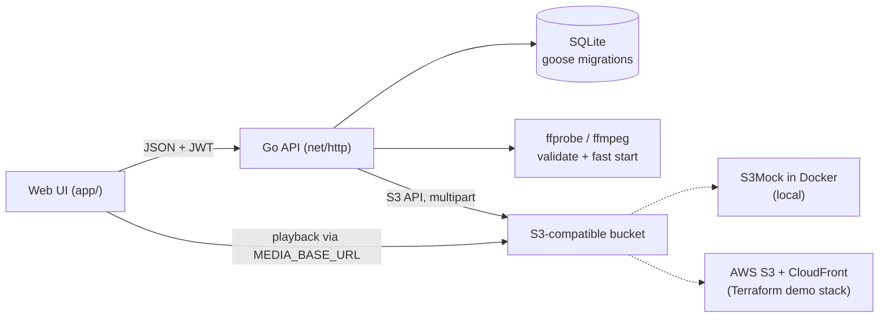
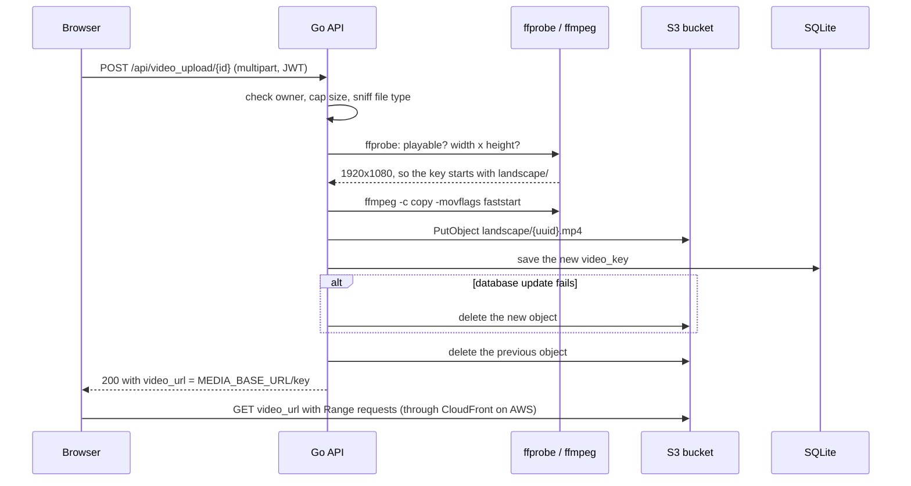
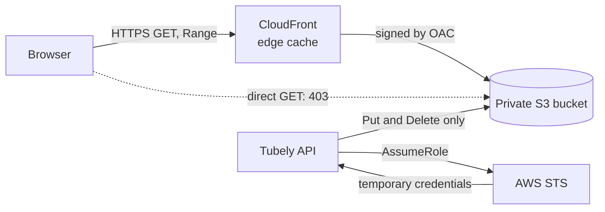

# Tubely

[](https://github.com/danielakinremi1-dev/Tubely-video-manager/actions/workflows/ci.yml)

Tubely is a video-hosting backend in Go. You upload an MP4, and Tubely checks it, remuxes it with ffmpeg so it plays instantly, stores it in S3 and streams it back through a CDN.

The whole thing runs on your machine with Docker, and you don't need an AWS account. The AWS side (a private S3 bucket behind CloudFront) is Terraform that's created for a demo and destroyed afterwards.

## Highlights

- **Uploads that check what they receive.** The file type is detected from its bytes, not the client's `Content-Type`. Size is capped at 1 GB for videos and 10 MB for thumbnails, and ffprobe confirms a video is playable. Every failure returns the right status code (`400`, `401`, `403`, `404`, `413`, `415`, `422` or `500`) with a JSON error.
- **Instant playback.** ffmpeg moves the MP4's `moov` index to the front (*fast start*), so the player can start and seek before the whole file has downloaded.
- **Reliable S3 transfers.** Files over 16 MiB go up as parallel 8 MiB multipart uploads with retries. Failed or cancelled uploads are aborted, so no parts are left behind.
- **No orphaned objects.** Replacing or deleting a video removes its old objects, and the steps are ordered so a failure halfway never leaves a row pointing at nothing.
- **Keys, not URLs.** The database stores object keys, and URLs are built per response from `MEDIA_BASE_URL`. Moving from the local emulator to CloudFront was a configuration change only.
- **AWS as code, with guardrails.** Terraform builds:
  - a private, encrypted bucket that only CloudFront can read (Origin Access Control);
  - an app role that can upload and delete but not read, with temporary credentials only;
  - a budget alert.

  `make aws-up` and `make aws-down` show the plan and ask before applying it. `aws-down` then checks that nothing is left.
- **Tested at every layer.**
  - Handler tests with in-memory fakes.
  - Integration tests against an S3 emulator.
  - An end-to-end smoke script.
  - CI on every pull request, running `-race`, the emulator tests and Terraform checks.

  `main` only accepts pull requests that pass.
- **Operational basics.** Structured logs with request IDs, server timeouts, graceful shutdown, a health check, and a non-root Docker image.
- **Auth.** Passwords are hashed with argon2id. Access tokens are JWTs that last an hour, and refresh tokens are stored so they can be revoked.

The reasoning behind these choices is in [docs/DESIGN.md](docs/DESIGN.md).

## Architecture



The API layer depends only on two interfaces, `storage.Store` and `media.Processor`. `cmd/tubely` plugs in S3 and FFmpeg; the tests plug in an in-memory store and a fake processor.

**One upload, step by step:**



**On AWS**, the bucket is private and CloudFront is its only reader:



## Quickstart

You need:
- [Go](https://go.dev/doc/install) 1.27 or newer, with a C compiler for the SQLite driver (cgo): `build-essential` on Debian/Ubuntu, or the Xcode command line tools on macOS;
- [Docker](https://docs.docker.com/get-docker/) with Compose v2, which runs the S3 emulator;
- [FFmpeg](https://ffmpeg.org/download.html), with both `ffmpeg` and `ffprobe` on your `PATH` (`sudo apt install ffmpeg` or `brew install ffmpeg`).

```bash
cp .env.example .env     # the local defaults work as they are
make dev                 # starts the S3 emulator (docker compose up -d), then the server
./samplesdownload.sh     # optional: sample videos and images in samples/
```

Open **http://localhost:8091/app/**, sign up, create a draft, and upload a video and a thumbnail. Requests to `/` return 404 by design; the UI lives at `/app/`.

**Or run everything in Docker**, with no Go or ffmpeg on your machine:

```bash
make up-app              # builds the image and starts S3 + the API on :8091
```

To stop, run `make down`. Uploads are kept; `docker compose down -v` deletes them too. To inspect the database by hand, install [SQLite 3](https://www.sqlite.org/download.html).

## What runs where

| Piece | Locally (default) | AWS demo stack |
|---|---|---|
| API and web UI | `go run ./cmd/tubely`, or the Docker image (`make up-app`) | Still on your machine (`make dev-aws`) |
| Database | SQLite file (`DB_PATH`) | SQLite file (`tubely-aws.db`) |
| Media storage | [S3Mock](https://github.com/adobe/S3Mock) in Docker on `:9090` | Private S3 bucket, served through CloudFront with Origin Access Control |

The AWS stack is Terraform in [`infra/`](infra). `make aws-up` creates it for a demo, and `make aws-down` destroys it and checks that nothing is left. It isn't kept running, to avoid charges.

It was last demonstrated end to end on 2026-11-09 and then destroyed:
- the smoke test passed against CloudFront;
- direct S3 reads were denied;
- the app's role could upload and delete, but not read.

The runbook is [docs/AWS_DEMO.md](docs/AWS_DEMO.md). The app's code is the same in both setups; only the configuration changes.

## API

Protected routes need `Authorization: Bearer <access token>`. Errors look like `{"error": "..."}`.

**Access model:**
- Videos are private. Every video route requires an access token, and only the video's owner can read, change or delete it. Anyone else gets `403`.
- Media files are served from unguessable URLs (`<prefix>/<uuid>.mp4`). Anyone you give that URL to can play the file.
- Truly private media needs signed URLs. They're planned; see [the design note](docs/DESIGN.md#cdn-urls-vs-presigned-urls).

| Method and path | Auth | Description |
|---|---|---|
| `GET /api/healthz` | none | `{"status":"ok"}` when the database is reachable, else `503` |
| `POST /api/users` | none | Sign up with `{"email", "password"}` → `201` |
| `POST /api/login` | none | Returns the user plus `token` (access) and `refresh_token` |
| `POST /api/refresh` | refresh token | Returns a new access token |
| `POST /api/revoke` | refresh token | Revokes the refresh token → `204` |
| `POST /api/videos` | access token | Creates a draft from `{"title", "description"}` → `201`. Titles are required and at most 100 characters. |
| `GET /api/videos` | access token | Lists your videos, newest first |
| `GET /api/videos/{videoID}` | owner | Returns one of your videos |
| `DELETE /api/videos/{videoID}` | owner | Deletes the video and its stored media → `204` |
| `POST /api/video_upload/{videoID}` | owner | Multipart field `video`: an MP4 up to 1 GB |
| `POST /api/thumbnail_upload/{videoID}` | owner | Multipart field `thumbnail`: a PNG or JPEG up to 10 MB |
| `POST /admin/reset` | none | Deletes all data. Only works when `PLATFORM=dev`. |

## Configuration

All settings are environment variables, read from `.env` if it exists. The defaults in `.env.example` target the local emulator.

| Variable | Required | Purpose |
|---|---|---|
| `DB_PATH` | yes | SQLite database file, created if missing |
| `JWT_SECRET` | yes | Secret used to sign access tokens |
| `PLATFORM` | yes | `dev` enables `POST /admin/reset` |
| `FILEPATH_ROOT` | yes | Directory the web UI is served from (`./app`) |
| `PORT` | yes | HTTP port |
| `S3_BUCKET`, `S3_REGION` | yes | Media bucket and its region |
| `MEDIA_BASE_URL` | yes* | Public base URL that object keys are served from |
| `S3_ENDPOINT` | no | Custom S3 endpoint, such as the emulator. Leave it unset for AWS. |
| `S3_FORCE_PATH_STYLE` | no | `true` for emulators, which need `host/bucket/key` URLs |
| `AWS_ACCESS_KEY_ID`, `AWS_SECRET_ACCESS_KEY` | no | Placeholders for the emulator. On AWS, use your normal credentials or profile. |
| `S3_ROLE_ARN` | no | A role to assume for temporary S3 credentials (the AWS demo uses one) |

\* `S3_CF_DISTRO` (a CloudFront domain) is still accepted in place of `MEDIA_BASE_URL`, for older configurations.

To use a different settings file, set `ENV_FILE` in your shell. For example, `ENV_FILE=.env.aws` (what `make dev-aws` does) reads only that file.

## Testing and CI

```bash
make check                 # go build, go vet and go test (no network, no Docker)
make lint                  # golangci-lint (uses Docker if it isn't installed)
make test-integration      # also runs the S3 tests against the emulator (starts it)
make up-app && make smoke  # end-to-end check against the running containers
```

**Unit and handler tests** cover:
- the auth helpers, including bearer-header parsing and HS256-only JWTs;
- database queries and migrations, including adopting older databases and a rollback round trip;
- middleware (request IDs, access logs, panic recovery), timeouts and graceful shutdown;
- ffprobe and fast start, against small sample files in `internal/media/testdata`;
- the whole upload path through the real router, with every failure mode. Each one is checked to leave no objects, no key change and no temp files.

**Integration tests** run against S3Mock:
- single-part, multipart and cancelled uploads;
- one full pass through the API, using real ffmpeg: upload, play the video from the URL built from its key, delete, and check that the objects are gone.

**`scripts/smoke.sh`** drives a running server over HTTP: every error code, a 40 MB multipart upload, a client disconnect, playback, Range requests and delete. It then audits the bucket and temp directory for leftovers.

**[CI](.github/workflows/ci.yml)** runs on every pull request and every push to `main`. It uses the same `make` targets and pinned tool versions as a local checkout:
- **lint:** `gofmt`, `go vet`, `make lint`;
- **test:** `go test -race` with coverage, with ffmpeg installed and S3Mock as a service container, so the integration tests run rather than skip;
- **terraform:** `make tf-fmt tf-validate tf-scan`, with no AWS credentials. CI never plans or applies.

`main` is protected ([`scripts/protect-main.sh`](scripts/protect-main.sh)). Changes arrive by pull request, and a pull request merges only when all three jobs pass on a branch that's up to date with `main`.

## Project layout

```
cmd/tubely/               main: config from env, wiring, server start
internal/api/             HTTP layer: routes, handlers, upload validation, JSON helpers
internal/storage/         Store interface: S3 (multipart) and in-memory
internal/media/           Processor interface: ffprobe/ffmpeg and a test fake
internal/database/        hand-written SQL and goose migrations
internal/auth/            JWTs, refresh tokens, password hashing
app/                      web UI (vanilla JS, no build step)
infra/                    Terraform for the AWS demo stack (S3, CloudFront, IAM, budget)
scripts/                  smoke test; AWS up, down and verify-clean; branch protection
docs/                     DESIGN.md (decisions), AWS_DEMO.md (runbook), ROADMAP.md
.github/                  CI workflow and Dependabot
```

## Status

Phases 0 to 4 of the [roadmap](docs/ROADMAP.md) are done: crash fixes, local S3 storage, a correct upload pipeline, a tested layered structure, Terraform for AWS, and CI. Phase 5, documentation, is in progress.

After that comes the roadmap's *Later* section: signed URLs for private media, asynchronous processing, and direct-to-S3 uploads.

## Credits

Starter boilerplate from [boot.dev](https://www.boot.dev/courses/learn-file-servers-s3-cloudfront-golang).
