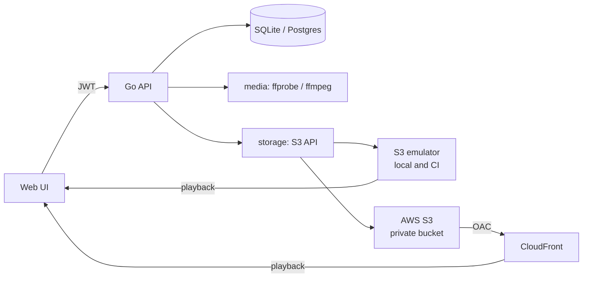

# Tubely roadmap

Tubely is being developed in phases from a single-binary course project into a production-shaped video service. Each checkbox is meant to be one reviewable commit. A phase is finished when every box is ticked and its **Done when** check passes.

**Guiding constraint:** everything runs locally with no cloud account. The same code deploys to AWS (S3 + CloudFront) through Terraform, and that environment is temporary: it's created for a demo and destroyed after.

## Architecture

**Today:** one Go process. It handles auth, runs ffmpeg in the request path, and writes to S3. Thumbnails live on local disk. Full public CDN URLs are stored in SQLite.

**Target:**

Design rules the phases build toward:
- **Store object keys, not URLs.** Public URLs are built at response time from `MEDIA_BASE_URL`, so changing the storage backend or CDN needs no data migration.
- **Put storage and media behind interfaces**, so handlers can be tested with fakes and the S3 backend can be swapped through configuration.
- **Short-lived access tokens plus refresh tokens kept in the database**, so sessions can be revoked.

---

## Phase 0: Foundations and crash fixes ✅

- [x] Module renamed to `github.com/danielakinremi1-dev/tubely`; stray binary removed and ignored
- [x] `/api/refresh` no longer panics on an unknown token (`database.ErrNotFound` → 401)
- [x] Revoked and expired refresh tokens are rejected
- [x] Missing videos return 404 on get, delete and both upload endpoints
- [x] Access tokens last 1h; the web UI refreshes them transparently and revokes them on logout
- [x] Removed the unused `lib/pq` import; `golang-jwt/jwt/v5` moved from a pre-release to stable
- [x] Fixed the `DB_PATH` error message; removed a debug print

## Phase 0.5: S3-compatible storage that runs locally

Uploads and playback currently depend on an AWS stack that no longer exists. This phase makes the storage backend configurable and runnable on a laptop.

- [x] Configurable S3 client: optional `S3_ENDPOINT` and `S3_FORCE_PATH_STYLE`, set through `s3.Options.BaseEndpoint` / `UsePathStyle`. Empty means real AWS.
- [x] `MEDIA_BASE_URL` for public playback URLs. It falls back to `https://$S3_CF_DISTRO`, and `S3_CF_DISTRO` becomes optional.
- [ ] Store object keys instead of URLs: add a `video_key` column (a guarded `ALTER TABLE`, because the current migration only creates tables), backfill keys from existing URL paths, and build URLs at response time.
- [ ] Thumbnails go into the same bucket under `thumbnails/`. Remove the local `assets/` storage and the hard-coded `http://localhost` URL.
- [ ] Deleting a video removes its video and thumbnail objects, and a re-upload removes the previous object. Storage errors are logged, and the row is still deleted.
- [ ] Upload-path fixes needed for local testing: the `other/` key prefix, `getVideoAspectRatio` error handling (the `cmd.Run()` error, no streams, zero height, `-select_streams v:0`), and closing and removing the `.processing` file.
- [ ] `docker-compose.yml` with **`adobe/s3mock:5.2.3`** (Apache 2.0, no account, port 9090). It creates the bucket on startup with `COM_ADOBE_TESTING_S3MOCK_STORE_INITIAL_BUCKETS=tubely-local` and allows public reads, which is fine because it only runs locally. It is path-style only, so the local settings are `S3_FORCE_PATH_STYLE=true` and `MEDIA_BASE_URL=http://localhost:9090/tubely-local`.
- [x] Verify that the emulator serves unsigned browser GETs and HTTP Range requests (needed for video seeking). If either fails, switch to SeaweedFS.
- [ ] `.env.example` with working local defaults, plus a `Makefile` with `up`, `down`, `dev` and `test`.

*Emulators not chosen:* LocalStack (new images require an auth token, which breaks "fresh clone just works" and would need a CI secret), MinIO (community edition archived, images removed), Garage (too much setup for local dev).

**Done when:** a fresh clone, then `cp .env.example .env && docker compose up && go run .`, gives a working upload and playback in the browser with no AWS credentials on the machine.

## Phase 1: Upload pipeline correctness

**Video upload**
- [ ] `exec.CommandContext` with a timeout for ffmpeg/ffprobe, with stderr captured in the returned error
- [ ] Use `r.Context()` for S3 calls so a cancelled request stops the upload
- [ ] `uuid.NewString()` for object keys instead of unchecked `rand.Read`
- [ ] Ownership mismatch returns 403 with a JSON error, not 401 with `{}`
- [ ] Fix the "Missing Content-Type for thumbnail" message in the video handler
- [ ] Sniff the real content type (`http.DetectContentType`) instead of trusting the client header
- [ ] S3 upload manager (`feature/s3/manager`) for multipart uploads of large files

**Thumbnail upload**
- [ ] Check the `ParseMultipartForm` error and cap the body with `http.MaxBytesReader` (10 MB)

**Database**
- [ ] Schema fixes: `videos.user_id` becomes `TEXT`, the `video_url TEXT TEXT` typo is fixed, and foreign keys get `ON DELETE CASCADE`
- [ ] Turn on SQLite foreign-key enforcement (`_foreign_keys=on`)
- [ ] `UpdateVideo` sets `updated_at` and stops passing pointer-to-pointer arguments
- [ ] Versioned migrations with goose. The baseline matches the current schema, including `video_key`.
- [ ] *Optional:* PostgreSQL + sqlc behind a `database` interface

**Request handling**
- [ ] JSON decode errors return 400
- [ ] Validate video titles: required, with a length limit

**Done when:** every upload failure mode returns the correct 4xx/5xx with a JSON error, and no temp files or orphaned objects are left behind.

## Phase 2: Structure and operability

**Structure**
- [ ] Split into `cmd/tubely`, `internal/api`, `internal/auth`, `internal/database`, `internal/storage` (interface) and `internal/media` (interface)
- [ ] `requireAuth` middleware that puts the user ID into the request context (it replaces six copies of the JWT parsing)

**Operations**
- [ ] `http.Server` timeouts, with longer limits for the upload routes
- [ ] Graceful shutdown on SIGINT/SIGTERM
- [ ] `log/slog` structured logging, request-ID middleware and panic recovery
- [ ] Startup check that ffmpeg/ffprobe are on PATH, plus `GET /api/healthz`

**Tests and packaging**
- [ ] Unit tests: `getExtension`, the aspect-ratio classifier (as a pure function) and the auth helpers
- [ ] Handler tests with `httptest` and fake storage/media implementations
- [ ] A small sample mp4 in `testdata/` for ffprobe tests
- [ ] Multi-stage `Dockerfile` with ffmpeg, and an `app` service in compose
- [ ] `make lint`

**Done when:** handlers have no direct AWS or ffmpeg calls, and `go test ./...` covers the main upload path without network access.

## Phase 3: AWS infrastructure as code

- [ ] `infra/` Terraform with the provider pinned. Private S3 bucket (all public access blocked, `force_destroy`, 7-day expiry lifecycle rule).
- [ ] CloudFront with Origin Access Control, `PriceClass_100`, HTTPS only, and a bucket policy limited to that distribution
- [ ] Least-privilege IAM for the app: `s3:GetObject`, `s3:PutObject` and `s3:DeleteObject` on `bucket/*` only
- [ ] AWS Budgets alert ($1 actual, $5 forecast), included in the first apply
- [ ] Every resource tagged `Project=tubely`; outputs for `bucket_name` and `cloudfront_domain`; local state only (git-ignored)
- [ ] `docs/AWS_DEMO.md` runbook plus `make aws-up` (apply, then write `.env.aws`) and `make aws-down` (destroy, then check that nothing tagged `Project=tubely` is left)

**Done when:** `make aws-up` → upload and play a video → `make aws-down` works end to end.

## Phase 4: Continuous integration

- [ ] GitHub Actions: `gofmt`, `go vet`, golangci-lint, and `go test -race -cover` (with ffmpeg installed)
- [ ] Integration tests against the S3 emulator as a service container: upload → key stored → URL built → delete removes the object
- [ ] `terraform fmt -check` and `terraform validate`. No `apply` and no AWS credentials in CI.
- [ ] CI badge in the README

## Phase 5: Documentation

- [ ] README rewrite: overview, demo GIF, architecture diagram, local quickstart, API table, and credits for the course this project started from
- [ ] Design notes: fast-start (`moov` atom) for streaming, CloudFront vs. a public bucket, presigned vs. CDN URLs, aspect-ratio key prefixes, keys vs. URLs

## Later

- [ ] Asynchronous processing: the upload returns `202 Accepted`, and a worker pool runs ffprobe/ffmpeg and the upload with retries (`processing → ready | failed`). The UI polls for status.
- [ ] Direct-to-S3 uploads with presigned PUT URLs, so large files never pass through the API
- [ ] Automatic thumbnail generation with ffmpeg when none is uploaded
- [ ] HLS transcoding into multiple renditions for adaptive streaming
